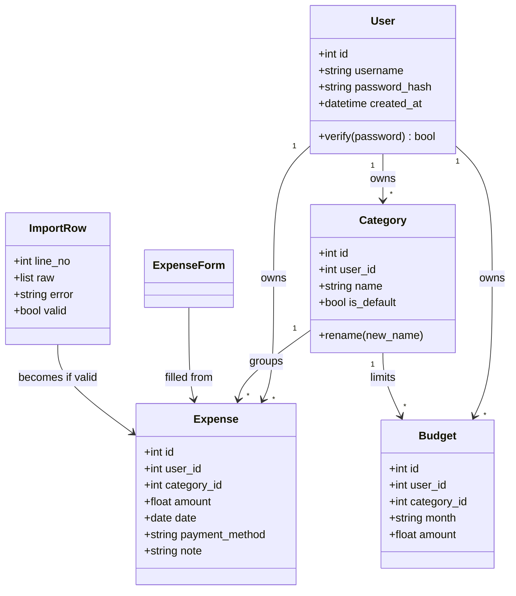
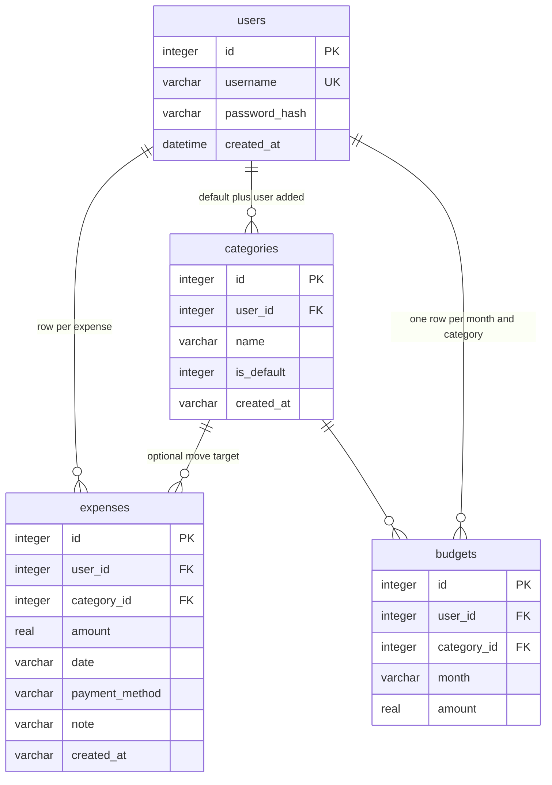
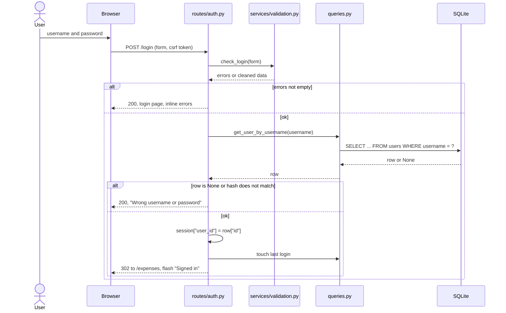
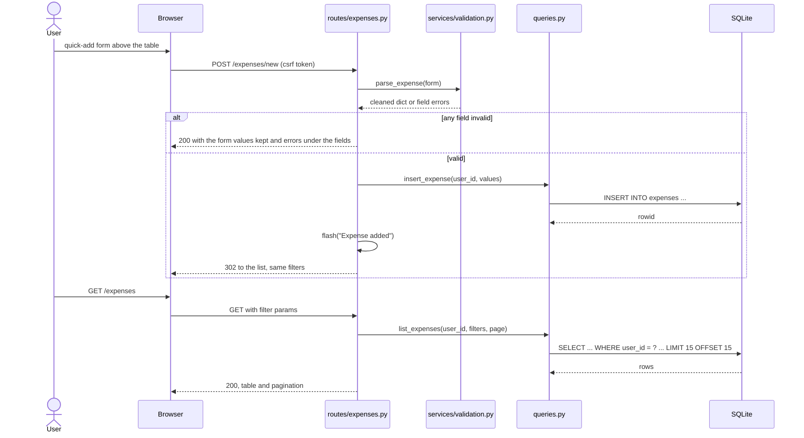

# Design

This document holds the models we built in sprint 1 and kept up to date afterwards: the use case diagram, the class diagram, the entity relationship diagram, two sequence diagrams, an activity diagram for CSV import, a short note on the layers, and the reasoning behind colour and type.

## 1. Use case diagram

```mermaid
usecaseDiagram
    actor Guest
    actor "Signed in user" as User
    package "Online Expense Tracker" {
        usecase "Register (FR-1)" as UC1
        usecase "Log in (FR-2)" as UC2
        usecase "Log out" as UC3
        usecase "Add expense (FR-5)" as UC4
        usecase "Edit expense (FR-6)" as UC5
        usecase "Delete expense (FR-7)" as UC6
        usecase "Filter and search list (FR-10, FR-11)" as UC7
        usecase "Manage categories (FR-14, FR-15)" as UC8
        usecase "Set monthly budget (FR-17)" as UC9
        usecase "Read dashboard (FR-19 to FR-23)" as UC10
        usecase "Export CSV (FR-24)" as UC11
        usecase "Import CSV (FR-25, FR-26)" as UC12
        usecase "Change password (FR-3)" as UC13
    }
    Guest --> UC1
    Guest --> UC2
    User --> UC3
    User --> UC4
    User --> UC5
    User --> UC6
    User --> UC7
    User --> UC8
    User --> UC9
    User --> UC10
    User --> UC11
    User --> UC12
    User --> UC13
    UC2 ..> UC1 : <<include>>
    UC6 ..> UC4 : "confirmed by"
    UC12 ..> UC8 : <<include>>
    UC9 ..> UC8 : <<include>>
```

Only one human actor exists. We drew Guest and Signed in user separately because they see different pages, and the include arrows show which cases are useless on their own: you cannot import a category that the system does not know, and a budget has no meaning without a category.

## 2. Class diagram

The data model is four tables and a handful of small classes used for form data. There is no class for a repository or a service layer, because plain functions were shorter in every case we tried.



`ExpenseForm` is a plain class holding cleaned values plus a dict of field errors. We use a class here only because a function returning four values was getting hard to read at every call site.

## 3. Entity relationship diagram



Every table carries `user_id`, and every query in `app/queries.py` filters on it. We chose that over a separate ownership table because the check is one line in the WHERE clause and it is easy to grep for.

`budgets` has a unique key on `(user_id, category_id, month)` so a second save updates the same row instead of creating a second one.

Amounts are stored as `real`. We know floats are not exact money, and we accepted it because SQLite has no decimal type and the values we handle are rupees with two decimals. This is listed as a limitation in the README.

## 4. Sequence: login



The password check runs against the stored hash with `werkzeug.security.check_password_hash`. The username is selected first and the hash compared in Python, so a missing user and a wrong password return the same message and cannot be told apart from outside.

## 5. Sequence: add expense



Validation runs before any SQL, and the route never formats an amount itself. The list after a quick-add keeps the filters that were on screen, which is the acceptance criterion of US-12.

## 6. Activity: CSV import

```mermaid
flowchart TD
    A[Upload .csv file] --> B{File present and ends with .csv?}
    B -- no --> C[Flash "Choose a CSV file first"]
    C --> A
    B -- yes --> D[Read rows with csv.reader]
    D --> E{Header matches expected columns?}
    E -- no --> F[Flash "Header must be date,category,amount,payment_method,note"]
    F --> A
    E -- yes --> G[For each row check date, amount, category]
    G --> H[Row valid?]
    H -- yes --> I[Mark valid, no write yet]
    H -- no --> J[Mark invalid, record reason]
    J --> I
    I --> K[Show preview table with line number, row, error]
    K --> L{User confirms?}
    L -- Cancel --> M[Nothing written, back to upload]
    L -- Import valid rows --> N[Insert each valid row in one transaction]
    N --> O[Flash "17 added, 3 skipped"]
    O --> P[Expense list]
```

The preview step is what makes this safe. No row reaches the database before the user has seen the error column, and invalid rows are never written, not even after confirmation.

## 7. The layers and why the SQL sits in one file

The request path is short: a route reads the request, calls one validation or summary function, calls a query function, then renders a template. Four layers, and the top one is the only one that knows about Flask.

`app/routes/*.py` holds the routes and nothing else. Each file is one screen of the product: auth, expenses, categories, budgets, dashboard, data. A route is usually ten lines. If a route starts doing arithmetic, we move that into `app/services/` instead, which is how `summary.py` and `budgets.py` grew during sprint 3.

`app/services/` has four modules. `validation.py` turns form data into cleaned values or a dict of errors and has no Flask import at all, which is why its unit tests are fast. `budgets.py` decides the state of a bar: normal, ochre at 80 percent, brick at 100 percent or above. `summary.py` builds the month totals, the comparison with the previous month and the daily series. `csv_io.py` parses an uploaded file into rows with a validity flag and error text, and writes export files.

`app/queries.py` is where every SQL statement lives. Two reasons. First, the course asks us to show that the system is easy to change, and one file of plain functions with the table names visible at a glance is the cheapest way to review every statement the program runs. Second, when we added indexes in sprint 3 we could see all the WHERE clauses together and add them in one place. It also gives the tests one target: a query bug shows up as a wrong result, and we know exactly which file to open.

`app/db.py` opens a connection per request and runs `schema.sql` on a fresh file. `app/__init__.py` is the app factory, which the tests use to build a small app against a temporary database.

We deliberately did not introduce base classes, abstract interfaces or injected dependencies. Every attempt to do so in a module this size produced more code than it removed.

## 8. Colour and font choices

The page is paper, so the background is `#F6F2E9`, a warm off-white, and cards are `#FFFDF8`, one shade lighter. Everything divides with a 1px line in `#DDD5C4` instead of a shadow, because a printed ledger has rules and not boxes. Text is `#1E2420` and secondary text `#6B6A60`.

We picked deep green `#2F5D50` for buttons, links and the active nav item as the one accent, since green ink is what a cash book uses for the balance. Two escalation colours carry meaning only: ochre `#B8851F` when a budget reaches 80 percent and brick `#A64B2A` at 100 percent and for every validation error. Brick is never used for anything decorative, so when the user sees it, something needs attention.

Headings are Source Serif 4, which gives the month title and the total the look of a printed statement. Body text is IBM Plex Sans at 14px, and every amount, date and page number is IBM Plex Mono with tabular numbers so that digits line up down a column. Amounts are right aligned for the same reason. The three families are loaded from Google Fonts with fallback stacks in the CSS, and the layout does not depend on them arriving.

Chart colours come from the same five values, gridlines use the border colour, and animation is switched off so the chart does not move while it is being read.
